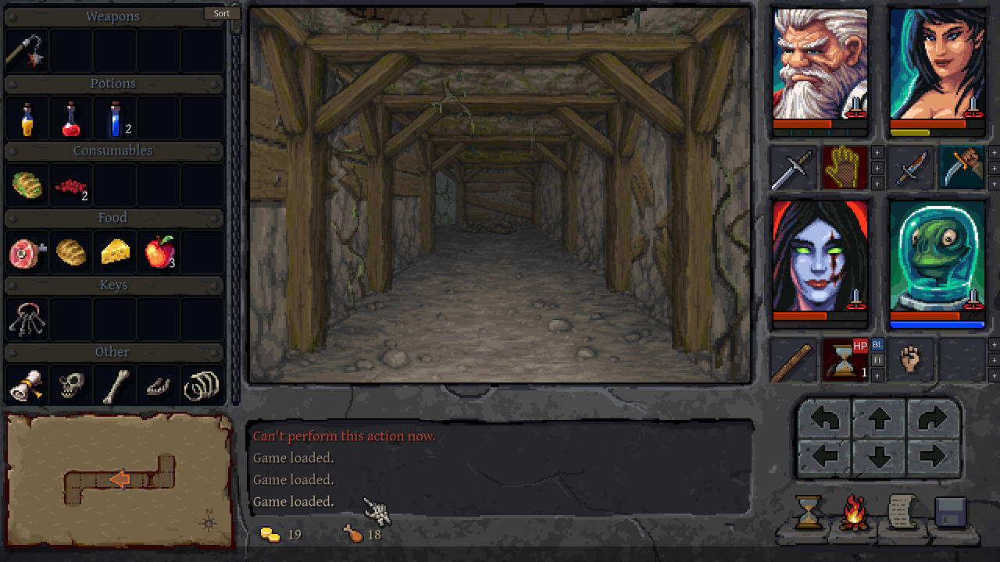
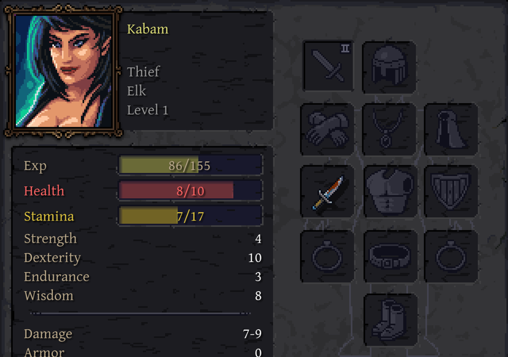
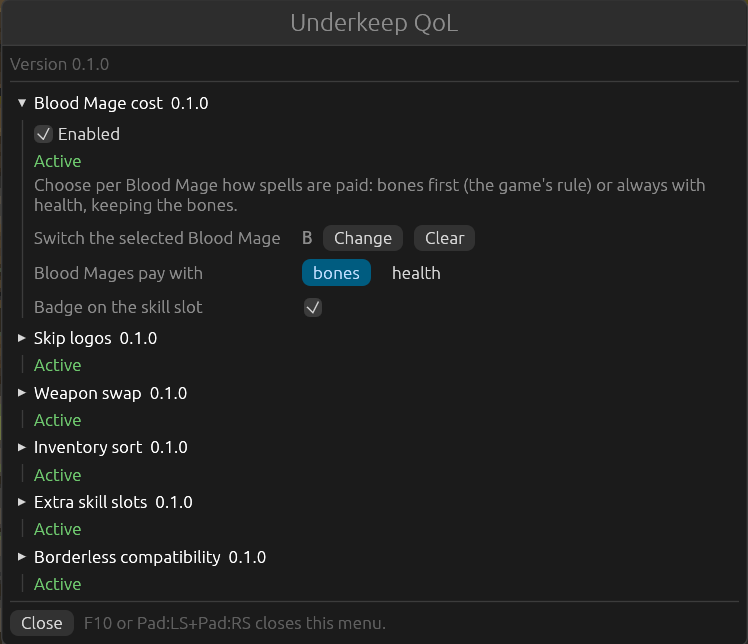
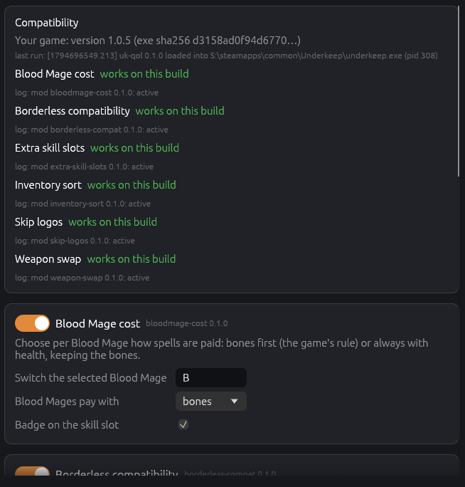

# Underkeep QoL

A mod loader and a set of quality-of-life mods for **Underkeep**, for the
**Steam** version of the game, on Windows and on Linux / Steam Deck (Proton).

Underkeep has no official mod support. This project adds it in a way that:

- **never modifies the game's own files**, so Steam's *Verify integrity* and
  game updates can't break or undo it, and uninstalling is just removing one
  DLL;
- **survives game patches**: mods find the code they change by byte patterns,
  not fixed addresses. A mod whose patterns aren't found on your game version
  turns itself off and says so, and the game still starts normally;
- **keeps your saves loadable without the mods**: the save file format is never
  changed. Anything a mod has to remember lives in a separate file next to the save.

**Status:** released. The current version is
[1.0.15](https://github.com/jjanow/underkeep-qol/releases/latest), for the
current game version, 1.0.6. Older game versions aren't supported: Steam
always updates the game to the latest version. The loader, overlay (F10 / L3+R3), manager and the first six mods are
tested on Windows and on Linux with Proton; `item-highlight` (new in 1.0.2)
only on Linux with Proton so far, as is `melee-accuracy` (new in 1.0.5; its
formula choices, new in 1.0.6, haven't been tried in game yet) and
`learned-recipes` (new in 1.0.7) and weapon-swap's game tooltip on slot II
(new in 1.0.8) and extra-skill-slots' game tooltip (new in 1.0.10)
and `shop-sort` (new in 1.0.11) and `party-numbers`, `enemy-health` and
`hidden-stats` (new in 1.0.13, tested on game 1.0.6);
weapon-swap's `messages` setting (new in 1.0.9) hasn't been tried in game
yet, and the manager keeping other launch options when it sets ours (new in
1.0.14) is unit-tested only. Steam Deck and macOS bottles are
expected to work but haven't been tested; reports are welcome in the
[issues](https://github.com/jjanow/underkeep-qol/issues).

## Mods

| Mod | What it does |
|---|---|
| `bloodmage-cost` | Choose how Blood Mages pay for spells: bones, or their own health. |
| `inventory-sort` | Sort an inventory with one key press or button. |
| `weapon-swap` | A second weapon slot on each hero's character sheet and a key to swap to it. |
| `extra-skill-slots` | More active-skill slots per hero, so you stop swapping skills in and out. |
| `skip-logos` | Go straight to the main menu: no studio and audio logos at startup. |
| `borderless-compat` | Borderless fullscreen stays a real borderless window (fast Alt+Tab, HDR works) instead of taking over the screen. |
| `item-highlight` | Items on the ground, containers and switches glow in the dungeon view (bright green by default); **H** turns it off and on. |
| `melee-accuracy` | Melee hit chance from the hero's stats, as ranged hit chance comes from Dexterity: a bonus from the weapon's stat, a ranged-style Strength + Dexterity formula, or your own formula. **Off by default**: it changes the game's balance. |
| `learned-recipes` | Recipes you have already learned get a green check mark on their icon in the inventory and in shops, and every recipe's tooltip says **Learned** or **Not learned yet**. |
| `shop-sort` | The merchant's list in every shop stays sorted: swords together, axes together, helmets together, boots together, and so on, cheapest first. |
| `party-numbers` | Each hero's health and stamina, mana or Zeal as numbers on the portrait bars (34/50, 34 or 68%), so you don't have to open the character sheet to check them. |
| `enemy-health` | Each enemy's health as numbers (23/40, 23 or 58%) with the game's own enemy health bar. **Off by default**: the game shows only the bar. |
| `hidden-stats` | The stats the game keeps hidden, added to each hero's stats page: hit chances, damage bonuses, armor ignored, armor against melee and ranged attacks, evasion cap, void resistance, element and spell bonuses, healing bonuses, immunities and more, each with a description. |

Details for each are in [Mod designs](#mod-designs).

## Screenshots

In game: the **Sort** button on the inventory, the Blood Mage's **HP** badge
and the extra skill slots (**BL**, **FI**, **+**) next to each hero's skill
slot.



| The second weapon slot (**II**) on the character sheet | The mod menu (F10) |
|---|---|
|  |  |

The manager: compatibility with your game build, and each mod's settings.



The in-game screenshots show Underkeep's own art, © Rake in Grass and its
publishers, used here only to show what the mods do.

## Installing

Downloads are on the [releases page](https://github.com/jjanow/underkeep-qol/releases).
Each release has the manager for Windows, Linux and macOS, the loader
(`uk-qol-runtime-windows-x64.zip`, one `winmm.dll`) and `SHA256SUMS`. You
only need the manager: it downloads the matching loader itself, or uses a
`winmm.dll` placed next to it.

Close the game first; the manager won't change files while it runs.

**Windows**

1. Download `uk-qol-windows-x64.exe` and run it.
2. It finds the game (or click **Browse…** and pick the folder with
   `underkeep.exe`). Click **Install**.
3. Start the game from Steam. **F10** opens the mod menu.

**Linux (Proton)**

1. Download `uk-qol-linux-x64.tar.gz`, unpack it and run `uk-qol`
   (`./uk-qol gui` from a terminal).
2. Click **Install**.
3. The game needs one Steam launch option, so Proton loads the mod loader:
   `WINEDLLOVERRIDES="winmm=n,b" %command%`. With Steam closed the manager
   can set it for you (**Set it in Steam for me**); otherwise click **Copy**
   and paste it in
   Steam, under the game's *Properties → General → Launch Options*.
4. Start the game. **F10** (or **L3+R3** on a gamepad) opens the mod menu.

**Steam Deck**: switch to Desktop Mode and follow the Linux steps, then go
back to Gaming Mode and play. Open the mod menu with **L3+R3**.

**macOS (CrossOver, Whisky, Wine)**: download `uk-qol-macos-arm64.tar.gz`,
run `uk-qol`, choose the game folder inside the bottle and click
**Install**. Then set a DLL override in the bottle: open its Wine
configuration (*winecfg*), and on the *Libraries* tab add `winmm` and set it
to *Native then Builtin*. Without it the bottle uses Wine's own winmm and no
mod loads. Checked in a Wine prefix with that override, not on a Mac.

**By hand**: unzip `winmm.dll` from the runtime zip into the game folder
(next to `underkeep.exe`), plus the launch option above on Linux. To remove
it, delete that `winmm.dll` and the `uk_qol` folder.

From the command line the same is `uk-qol install` (add
`--set-launch-option` on Linux); `uk-qol help` lists every command.

**Updating**: the manager checks for a new release when it starts and asks
before updating itself, the loader and the mod patterns (`uk-qol update`
from a terminal).

**Uninstalling**: move every weapon out of a second weapon slot into your
inventory in game first (see [`weapon-swap`](#weapon-swap)), close the game,
then **Uninstall** in the manager (`uk-qol uninstall`). On Linux remove the
launch option too. The files next to your saves are kept, so reinstalling
later brings the mods' state back.

**If the game misbehaves**: hold **Shift** while it starts to run it with
every mod off. After a game update a mod may turn itself off until its
patterns are updated; the mod menu says which one and why.

**With other mod loaders**: this loader can be installed next to another
one, such as the Underkeep Mod Framework (a `version.dll` that changes the
game's data and loads mods from a `mods` folder). They use different DLL
names, and the framework itself doesn't change the game code our mods
hook. Its mods can bring their own DLLs, though: if one of those changes a
function a mod here needs, that mod turns itself off and the mod menu says
why. On Linux each needs its own DLL
override, in one launch option:
`WINEDLLOVERRIDES="version=n,b;winmm=n,b" %command%`. The manager's **Set
it in Steam for me** adds ours to an override that is already there and
keeps your other launch options. Two limits when both are installed:

- The framework writes the game data its mods change as whole definitions
  that load after the game's own. When one of its mods changes a
  definition that a mod here also changes in memory (the text that
  `learned-recipes` adds, or your own `uk_qol/patches`), the framework's
  version wins. `learned-recipes` then shows its lines in English.
- Items added by the framework's mods have no picture in `weapon-swap`'s
  second slot; the slot shows the item's name instead.

This was checked by reading the framework's documentation and its DLL, not
by playing with both installed. `uk-qol report` lists other loaders it finds
in the game folder; please include it if something goes wrong with both.

## How it works

```
underkeep.exe ──loads──> SDL3.dll / fmod.dll ──import──> winmm.dll  (our proxy, in the game folder)
                                                            │
                                                            ├─ forwards every winmm call to the real system winmm.dll
                                                            └─ starts the mod runtime (uk_qol)
                                                                 ├─ identifies the game build (exe hash)
                                                                 ├─ loads enabled mods from  mods/
                                                                 ├─ resolves each mod's byte patterns, installs hooks
                                                                 ├─ patches game data in memory as it is loaded
                                                                 └─ draws the in-game overlay (settings, buttons)
```

### 1. Loader: a proxy `winmm.dll`

The game exe imports only `SDL3.dll`, `fmod.dll`, `steam_api64.dll` and core
Windows DLLs. `SDL3.dll` and `fmod.dll` both import `winmm.dll`, which isn't a
Windows "KnownDLL", so Windows (and Wine) look for it in the game folder first.
Our `winmm.dll` forwards all of winmm's exports to the real one in the system
folder and starts the mod runtime on a separate thread.

Why not the alternatives:

- Replacing `SDL3.dll`, `fmod.dll` or `steam_api64.dll` means overwriting game
  files, which updates and file verification put back.
- An external injector would need to run every time you start the game.

On **Linux** (Proton) Wine prefers its built-in winmm, so the game needs a DLL
override. In Steam, *Properties → Launch Options*:
`WINEDLLOVERRIDES="winmm=n,b" %command%`

This works on Windows with no extra setup, and under Steam (Flatpak) with
Proton: the runtime loads in game version 1.0.6 and audio, gamepad,
save/load and quit work normally.

The manager sets this up or prints the exact line to paste.

### 2. Mod runtime

Written in Rust, built as a Windows DLL (`x86_64-pc-windows-gnu`, cross-compiled
from Linux too).

- **Build detection.** Identifies the game build by the exe's SHA-256, so each
  build is treated as its own binary, and reads the version string the title
  screen shows (`version 1.0.6`). Both go into the log and bug reports.
- **Byte-pattern scanning.** Each mod lists the functions it needs as patterns
  with wildcards (`48 8B ?? ?? 0F 85 ...`) plus how to get from the match to the
  target. Patterns are resolved once at startup. If a required pattern finds no
  match or more than one, that mod is disabled and the reason is logged and
  shown in the overlay. Other mods keep working.
- **Hooks.** Function detours and small in-place patches, applied and removed
  as a unit per mod, so a mod can be turned off at runtime.
- **Data patches.** The game's definition files (`base/*.txt.rfile`, a binary
  "DfT" format) are patched in memory as the game reads them: change a value,
  add a record, move a HUD element. The files on disk are never touched.
- **Overlay.** The game renders with OpenGL through SDL3. The runtime hooks
  `SDL_GL_SwapWindow` and `SDL_PollEvent` (named SDL3 imports of the exe,
  redirected in its import table, not patterns) to draw an
  [egui](https://github.com/emilk/egui) overlay on the game's GL context and
  read input. **F10** (or **L3+R3** on a gamepad) opens the mod menu: enable
  and disable mods, change their settings, rebind their keys, see which ones
  failed to load and why. While it's open the game gets no input.
- **Hotkeys** are read from SDL input events, so they work the same with
  keyboard and gamepad and don't fight the game's own key bindings. Each mod's
  keys are configurable (`S`, `Shift+1`, `Pad:Y`, `Pad:LB+Pad:X`, …), and a
  key a mod handles never reaches the game. Hotkeys are off while you type in
  a game text field.
- **Logging** to `uk_qol/uk_qol.log` in the game folder. The first line names
  the version and the git commit of the build.

### 3. Mods

Each mod is one folder with a manifest:

```
mods/
  bloodmage-cost/
    mod.toml          # id, name, version, author, description
                      # supported game builds, conflicts, dependencies
                      # settings schema with defaults (drawn in the overlay)
    patterns.toml     # named byte patterns, per build if they differ
    patches/          # in-memory data patches for rfile definitions
```

Built-in mods are compiled into the runtime (Rust modules behind a common
`Mod` trait: `on_load`, `on_unload`, `on_frame`, `on_input`, `on_save`,
`on_load_save`). The folder layout and manifest are the same so that
data-only mods (patches, no code) can be dropped in by anyone later.

User settings live in `uk_qol/config.toml` in the game folder, one table per
mod. The overlay edits the same file.

### 4. Save safety

- The game's save files are never rewritten by a mod.
- State a mod must keep (the weapon in a second weapon slot, extra skill slot
  assignments, per-hero toggles) is written to a sidecar file next to the
  save, keyed by hero, whenever the game saves (menu, quick save,
  autosave), and read when it loads. Deleting a save in game deletes its
  sidecar; a new game starts every mod empty.
- Saves always load without the mods, with one exception the player must
  know about: **an item in a second weapon slot exists only in the sidecar file.**
  If the mods are removed, or the sidecar is lost (a deleted file, a
  computer that plays the save without the mods and Steam Cloud), that
  weapon is gone. See [`weapon-swap`](#weapon-swap).
- The game keeps its saves in Steam Cloud storage (its log says "Save
  location: Steam cloud"); on disk they are `save_1`, `save_auto`, … in
  Steam's `userdata/<account>/2411200/remote/` folder, not in the game folder
  or the Wine prefix. The game writes them only through Steam's cloud API.
- Sidecars go there too, as `qol_save_1.toml`, `qol_save_auto.toml`, …,
  written through the same API, so mod state follows a save to other
  computers and the Steam Deck. The game's load list doesn't show them.
- Without Steam the sidecars are kept locally, in
  `uk_qol/saves/<Steam account id or default>/<save>.qol.toml` in the game
  folder. Local sidecars from older versions are moved into the cloud the
  first time the game saves or loads with Steam (the newer copy wins); the
  local files are kept in `uk_qol/saves/<account>/migrated/` as a backup.

### 5. Manager

**Underkeep QoL Manager**, a desktop app for Windows, Linux / Steam Deck and
macOS (CrossOver / Whisky bottles), built like Underkeeper: one self-contained
file, nothing else to install, dark and light mode.

- Finds Steam installs on its own (Steam libraries, Flatpak, Proton, Wine
  bottles), or lets you pick the folder.
- **Install / Uninstall** buttons. Emptying second weapon slots before an
  uninstall is up to the player (see [`weapon-swap`](#weapon-swap)). On Linux
  it shows the launch option to paste, with a copy button, and checks whether
  it's set in Steam.
- A mod list with on/off switches and each mod's settings.
- A **compatibility** panel: your game build, and for each mod whether it works
  on it.
- **Updates itself** and the installed mods from this repository's GitHub
  releases, after asking, with SHA-256 checks.
- Refuses to install or change files while the game is running.

The same actions are available as a command line, for scripts and support:

```
uk-qol detect                  # find Steam installs (Steam libraries, Flatpak,
                               # Wine bottles), show the game build
uk-qol install [--game PATH]   # copy winmm.dll + runtime + mods, print/set the
                               # Linux launch option
uk-qol status                  # installed version, game build, which mods work on it
uk-qol enable  <mod>           # same as toggling in the overlay
uk-qol disable <mod>
uk-qol config  <mod> <key> <value>
uk-qol uninstall               # remove everything the installer added (warns
                               # about weapons left in second slots first)
uk-qol report                  # bundle log, config and build info for a bug report
uk-qol update                  # update the manager, loader and patterns from
                               # the latest release (asks first)
uk-qol reset-safe-mode         # turn the mods back on after safe mode
```

Install discovery and the DfT file parser are shared with
[Underkeeper](https://github.com/jjanow/underkeeper), the save editor.

## Mod designs

### `bloodmage-cost`

The game's rule: Blood Mage spells consume bones, and when you have none they
cost the Blood Mage's own health. This mod adds a setting per Blood Mage:

| Mode | Behavior |
|---|---|
| `bones` (game default) | Use bones; health only when out of bones. |
| `health` | Always pay with health, keep your bones. |

Toggled with a hotkey while the hero is selected, or by clicking the badge on
the Blood Mage's skill slot (**B** for bones, **HP** for health; setting
`hud_badge`). Implementation: hook the bone check in
the spell-cost path (the opcode handlers for Blood Mage skills feed into it)
and report "no bones" in `health` mode, so the game's own health payment runs.

### `inventory-sort`

Sorts the open inventory (party stash or a hero's bag).

- Order: the game's own inventory sections (weapons, armor, jewelry,
  potions, consumables, food, keys, other, recipes) stay as they are; inside
  each, by item type, then value high to low, then name.
- Stackable items are merged into full stacks first.
- Equipped items and hotbar / quick slots are never moved.
- A hotkey (default **Z**: the game uses S), and a small **Sort** button
  drawn by the overlay in the inventory panel's top-right corner while a sort
  is possible (setting `hud_button`). The result shows on screen ("Inventory
  sorted", "Inventory already sorted"): the game already keeps the sections
  apart, so a small inventory is often already in order.
- Runs only when nothing is being dragged and no trade window is mid-transaction.

### `weapon-swap`

Adds a **second weapon slot** to each hero's character sheet, left of the
helmet slot. It holds one spare weapon of any kind: a bow, a sword, a
two-handed weapon. A key swaps it with the equipped weapon in one action:
sword ⇄ bow, sword and shield ⇄ two-hander, one melee weapon ⇄ another.
Keys: **Shift+1..4** for heroes 1–4, plus one for the selected hero; all
rebindable.

- Move a weapon into the slot like into any equipment slot (the game picks
  items up with a click and drops them with the next). Requirements are
  checked when it's swapped in, like a normal equip.
- The weapon in the second slot gives no stats until it's swapped in.
- There is no second shield slot: the shield only has to move for a
  two-handed weapon, and the swap handles that (below).
- **In combat, a swap costs the hero's turn** by default. Setting:
  `swap_costs_turn = true | false`. Outside combat it's always free.
- Messages pop up at the bottom of the screen (setting `messages`): `all`
  (default), `problems` (only refusals and warnings, not the "swapped"
  report of a swap that worked) or `none`. The mod's section of the
  overlay menu always lists the last few.
- The game's save format has no room for this slot, so the weapon in it is
  stored in the save's sidecar file (see *Save safety*), not in the save.

How it works now (1.0.1; tested in game 1.0.5 with a gamepad, mouse and
keyboard):

- On the character sheet the slot sits left of the helmet slot, drawn like
  the game's empty weapon slot (its stone, highlights and sword icon, read
  from your game files) with a Roman numeral **II** in the corner (setting
  `sheet_slot`). Click it with a weapon on the cursor (picked up from the
  inventory or a hand) to put it in, or hold the button on a weapon and
  let go over the slot; a weapon already there goes to the inventory. Click
  the filled slot to pick its weapon up, then click the inventory panel
  (moves it there) or the weapon slot (swaps); a click anywhere else puts
  it back. A right click moves it straight to the inventory. The slot shows
  the stored weapon's own icon (read from your game files; its initials if
  the icon can't be read) and is framed green, or
  veiled red, while an item that fits or doesn't is on the cursor. The
  game's cursor and the item it carries draw over the mod's widgets, as
  over the game's own.
- Hovering a filled slot II shows the game's own tooltip for that weapon,
  as an inventory weapon gets on the sheet: its stats with the arrows
  comparing it to the weapon in hand, requirements in red if the hero
  falls short, and the weapon in hand in the **Equipped** panel beside it.
  Two lines at the bottom are the slot's (click to pick it up and swap,
  right-click to move it to the inventory, and the reminder below). How: the stored weapon isn't a game
  item, so the mod has the game build a temporary copy, write its tooltip
  text, and take the copy away again at once; the text is shown through
  the game's own tooltip, in the same place and with the same delay. If
  that part can't be set up (a pattern not found), the slot shows a plain
  text tooltip instead.
- With a gamepad (no mouse cursor) the same is in the mod's section of the
  overlay menu: per hero, **Put the weapon in hand in the slot**, **Put
  *item* in the slot** (for each weapon in the inventory), **Swap now** and
  **Move to inventory**. The slot can always be emptied back into the
  inventory there. A hero with a filled slot also gets a small button on
  their weapon hand slot on the HUD, showing the stored weapon's initials;
  clicking it swaps (setting `hud_button`).
- A swap is symmetric: after sword ⇄ bow the slot holds the sword, and the
  next swap brings it back. Only weapons go in, never items that stack.
- A weapon with an ability (e.g. a staff) keeps counting its cooldown down
  while it's in the slot, as it would in the inventory: one per turn and
  one per rest step.
- When heroes switch places in the party, each hero's second slot goes
  with them.
- Quest weapons (J'Axe, the Soulforge Axe) go in like any other. The game's
  quest scripts look for them in the party's inventory and equipment
  (`party_has_item`, `remove_party_item`), where the slot isn't, so when a
  script asks for a weapon that is in a second slot, the mod first moves it
  to the inventory and says so. The quest then sees it as without the mod.
- The swap goes through the game's own equip function, as when equipping
  from the inventory: class checks, the item's equip scripts, stats and HUD
  update like a manual equip. A weapon the hero can't use stays where it
  was, with nothing lost.
- A two-handed weapon pushes the shield into the inventory, as a manual
  equip does. Swapping back to a one-handed weapon puts that shield back on
  if it is still in the inventory. Between two one-handed weapons the
  shield stays on.
- In combat (the game's own "battle" check) a swap needs the hero to be able
  to act and the monsters not to be moving, then ends that hero's turn
  (`swap_costs_turn`) through the turn queue's "hero is done" action: the
  hero is greyed out, the next hero is selected, and the monsters act when
  everyone is done. During the monsters' turn a swap is refused. With
  `swap_costs_turn = false` the swap is free.
- If a save's sidecar doesn't match the save (e.g. it was saved while the
  mod was off), its weapons aren't put back in the slots; the menu lists
  them with a **Move to inventory** button, warning that they may already
  be in the party.

**What players are told** (here; slot II's tooltip has a one-line
reminder at the bottom):

```
A weapon in a second weapon slot is kept by the mod, not by the game.
If you remove the mod, reinstall the game, play the save on another computer,
or the mod's file next to your save is lost, that weapon is gone for good.
Before uninstalling, move every second-slot weapon back to your inventory.
```

### `extra-skill-slots`

Today each hero has one active-skill slot next to the basic attack. This mod
adds 3 more (configurable 1–5).

- New slots appear as small buttons in a column right of the hero's skill
  slot on the HUD, drawn by the overlay at the game's own layout positions
  and labelled with the skill's initials (the game's skill tooltip on
  hover). The
  game's layout can't take new slots (its code reads a fixed set of rects).
- Each new slot gets its own key binding (unbound by default, set in the
  overlay) for the selected hero, and its button casts it for that hero on a
  left click. Right-click (or a click on an empty slot) assigns a skill with
  the game's own skill panel; the mod's menu section has a list too.
- Assignments are stored in the save's sidecar file. Without the mod the hero
  just has their original slot.
- A cast from an extra slot goes through the game's own cast queue, the
  same path as its skill slot, so its checks apply ("Cooldown not finished
  yet!").
- A button turns red while its skill is on cooldown, and grey if the hero
  no longer has the skill, so you can see every option before you act. The
  menu list says "on cooldown" too.
- Hovering a button with a skill shows the game's own skill tooltip (the
  one its skill slot shows, in the same place), with a line under it about
  the slot and its clicks, and "On cooldown." while it is. Empty slots and
  skills the hero no longer has show the mod's short hover text. If the
  game's tooltip can't be found (a game update), every button falls back
  to that short text. The added lines are in English.
- The buttons show text labels, not the game's skill icons (setting
  `hud_buttons` turns them off).

### `skip-logos`

Each launch shows the Rake in Grass and FMOD logos (about 3 s) before the
main menu. This mod skips them, so the game starts on the main menu.

- The intro cinematic needs nothing: the game plays it once and then skips
  it on its own (`intro_was_played` in `game_config.txt`). The main menu's
  own reveal animation is left as is.
- It patches the per-frame check that keeps the logo running, so the game
  takes its own hand-over to the main menu right away. The game is held at
  startup until the patch is in, so the logos never show.
- One on/off switch, on by default; nothing saved.

### `borderless-compat`

The game draws with OpenGL. In its default borderless mode (Video settings →
Borderless Mode → **Performance**) Windows graphics drivers often take the
screen over as if it were exclusive fullscreen: Alt+Tab is slow and HDR
displays look wrong. The game's other borderless mode, **Compatibility**,
keeps a normal desktop window, but players have to know to pick it.

- The mod makes borderless fullscreen always use the Compatibility path,
  whatever the setting says. Windowed and exclusive fullscreen are
  unchanged.
- Side effect (the game's own, from its tooltip): screenshots and recordings
  can show a one-pixel edge.
- One on/off switch, on by default; nothing saved. It takes effect the next
  time the game sets the display mode (at start, or when a video setting
  changes).
- Under Proton/Wine the driver takeover doesn't happen, so it changes
  little there; it's meant for Windows. NVIDIA users can get the same
  result without the mod: NVIDIA Control Panel → *Vulkan/OpenGL present
  method* → *Prefer layered on DXGI swapchain*.

### `item-highlight`

Things you can pick up or use are easy to miss in the dungeon art. This mod
colors them, bright green by default, in the dungeon view.

- Three groups, each with its own switch: **items** on the ground or in
  alcoves; **containers** (chests until they're opened, alcoves and shelves
  while something is in them); **switches** (wall buttons, levers, secret
  buttons and keyholes).
- Only what the game draws is marked: anything behind a wall stays hidden,
  and the game's fog and shade still apply. The item under the cursor (or
  picked with the gamepad) keeps the game's own highlight.
- **H** turns the highlight off and on (a pad button can be bound; none by
  default). The choice is kept for the next game (setting `shown`).
- Settings: the **color**, its **strength** (0 only tints things, 1 colors
  them fully; default 0.85) and the three groups.
- How: the game draws each thing in the dungeon view as a sprite and already
  passes a "highlight" amount per sprite for its hover effect. The mod finds
  the sprites of the marked things (by the entity's class, from the exe's
  type information, so no byte pattern per class) and gives them the color
  and a highlight amount the game never uses itself. At startup it also adds
  one branch to the game's sprite shader, compiled in memory, that recolors
  only sprites with that amount; every other sprite, including the game's own
  hover highlight, draws exactly as before. Nothing in the game's files or
  saves changes.
- If the mod is turned on after the game has started, the shader is already
  compiled: things are then tinted with the game's plain white glow until
  the next start.

### `melee-accuracy`

In the game, a ranged hit chance is **DEX × 9** + ranged hit bonuses −
the enemy's evasion, but a melee hit chance is a flat **100** + melee hit
bonuses − evasion: no stat counts. This mod replaces that 100 with a
formula of the hero's stats; melee hit bonuses and evasion still apply as
in the game. Setting **formula** picks one:

- **`stat_bonus`** (default): **100 + stat × 2**. The stat is the one the
  game scales the attack's damage on: **Strength**, or **Dexterity** for
  weapons that scale with it (Scimitar, Embersand Saber, daggers);
  Strength when unarmed. A 6 STR Warrior gets +12, a 5 DEX Thief with a
  dagger +10. It only ever adds: the game's own chance is the floor (a stat
  lowered below 0 by a mutation adds nothing). Setting: **hit chance per
  point** (0 to 10, default 2).
- **`ranged_mirror`**: **(STR + DEX + 5) / 2 × 9**, the ranged rule with
  the average of Strength and Dexterity, so Thieves aren't left out.
  15 points of STR + DEX give 90 (as 10 DEX does at range), 14 give 86,
  17 give 99, 18 give 104, 20 give 113: **heroes with less than 18 hit less
  often than in the game.** (Before game 1.0.6 ranged was DEX × 10 and so
  was this formula; for the old numbers, use `custom` with
  `(STR + DEX + 5) / 2 * 10 + RS * 10`.) An attack
  that Righteous Strike empowers gets a flat **+10** on top, at every rank,
  so Paladins, who also want END and WIS, keep up. Setting: **Righteous
  Strike hit bonus** (0 to 50, default 10).
- **`custom`**: your own formula, in setting **custom formula**. It gives
  the base chance that replaces the 100. You can use numbers, `+ - * /`
  (`x` works for times), parentheses, `min(a, b, …)`, `max(a, b, …)` and
  these variables:
  - `STR`, `DEX`, `END`, `WIS`: the hero's current stats, gear and
    mutations included;
  - `WSTAT`: the weapon's stat (DEX for weapons that scale with it, else
    STR);
  - `RS`: 1 on an attack Righteous Strike empowers, else 0.

  The result is rounded at the end, so `/ 2` doesn't lose half points.
  Examples:
  - `100 + max(0, WSTAT * 2)` is `stat_bonus`;
  - `(STR + DEX + 5) / 2 * 9 + RS * 10` is `ranged_mirror`;
  - `max(100, 50 + STR * 8)` never goes below the game's chance.

  A formula with a mistake leaves melee to the game until it is fixed: a
  message says what is wrong, and so does the runtime log. A formula that
  divides by zero for some hero leaves that attack to the game.

Righteous Strike counts for the plain attack it empowers, as in the game,
not for weapon skills.

- Covers plain melee attacks and weapon skills, which use the same roll.
  Ranged attacks, thrown items and spells are unchanged; so are enemies'
  attacks.
- **Off by default**, because it changes the game's balance: turn it on in
  the overlay or the manager.
- The chance isn't shown on the character sheet (the game doesn't show a
  melee hit chance there either); the runtime log has one line per attack
  with the stats and the base chance used.
- How: the mod detours the game's hero melee attack and changes the hero's
  melee hit bonus by (formula − 100) for that one call, putting it back
  afterwards. Nothing in the game's files or saves changes.

### `learned-recipes`

To see whether you know a recipe, the game makes you find the mortar, open
the crafting menu and look through it. This mod shows it where you meet the
recipe:

- A **green check mark** on the icon of every recipe you have learned, in
  the inventory and in shops (your list and the merchant's).
- A line at the bottom of every recipe's tooltip, and in the shop's item
  panel: **✓ Learned** or **Not learned yet**, in the game's language.
- Settings: **check mark on learned recipes** and **learned line in the
  tooltip**, both on by default.

What counts as learned is what the game counts: a recipe is learned once
it's in the mortar's recipe list, and the game adds it there **the first
time you craft it**. Buying, finding or carrying the recipe item doesn't
teach it; the item shows the ingredients, so you can craft it and learn it.

Some potions have **two recipes with the same name** and different
ingredients: Healing, Mana and Endurance potions (from herbs, or from two
of the minor potion), Minor Mana (a second Moonpetal, or Ectoplasm) and
Cure Poison (Red Mushroom, or Spider Eye). The game learns each recipe on
its own, so after brewing one, the other recipe item of the same name
still says **Not learned yet**. The inventory tooltip lists the
ingredients, which tells the two apart; the shop's item panel doesn't
show them.

- How: the mod reads the party's learned-recipe list (the one the save
  keeps as `unlocked_recipes`). It detours the game's item tooltip
  function and appends the line with the game's own text functions; the
  two lines are text keys the mod adds to the game's text tables in
  memory (`uk_qol_recipe_learned`, `uk_qol_recipe_not_learned`), so a
  player's own data patch can reword them. It detours the drawing of item
  lists and queues the game's quest check-mark sprite on each learned
  recipe's icon, in the same batch as the icons, so the list's scrolling
  and clipping apply to it. Nothing in the game's files or saves changes.

### `shop-sort`

The game lists a merchant's goods by section (weapons, armor, jewelry,
potions, ...) but, inside a section, in the order the shop got them, so
swords, axes and bows are mixed, and so are helmets, boots and body armor.
This mod keeps the merchant's list sorted, every time a shop opens and
after every purchase or sale:

- Order: the game's sections stay as they are; inside each, by item type
  (shields, body armor, helmets, gloves, boots, cloaks each together), for
  weapons by kind (swords together, axes together, bows together, ...),
  then by price, **cheapest first**, then by name.
- Only the merchant's list. Your own side of the shop stays as you left it
  (sort it with `inventory-sort`).
- No settings: turn the mod off to get the game's order back.
- How: when a shop opens, the game copies the shop's stock into a temporary
  list for the screen and sorts that list (section, then the order the
  items came in) whenever it changes. The mod detours that step for the
  merchant's list only and renumbers the items' order just before the game
  sorts them. Buying and selling work on the item itself and change the
  shop's real stock by item name, so only the order on screen changes.
  Nothing in the game's files or saves changes.
- Turned on after the game has started, the tooltip lines are in English
  until the next start (the game reads its texts once).

### `party-numbers`

The game shows each hero's health and second bar under the portrait as
bars only; the numbers are on the character sheet. This mod writes them on
the bars:

- **Health** on the red bar, and on the second bar what the game shows
  there for the class: **stamina** (Warrior, Thief, Ranger), **mana**
  (Voidcaller, Wizard, Blood Mage) or **Zeal** (Paladin). A bar the game
  leaves empty because its maximum is 0 (a Blood Mage without mana) gets
  no number, and a fallen hero none at all.
- Settings: **Format** `current_max` (34/50, the default), `current` (34)
  or `percent` (68%); **Stamina, mana and Zeal too** (off: health only);
  **Text size** (6 HUD pixels by default, the bars' spacing); **Numbers on**
  with a toggle key and pad button, both unbound by default.
- Also shown while you pick a target for a skill or spell (healing an ally,
  say), when other mods' HUD buttons hide.
- How: it reads the values the game's own bars are drawn from and paints
  the numbers with the mod overlay. Nothing in the game's state, files or
  saves changes.

### `enemy-health`

In a fight the game draws a health bar, with the enemy's name in it, for each
enemy the party faces, but no numbers, so you can't tell a 12-health rat from
a 120-health brute until the bar starts to move. This mod writes the numbers
with the game's bar. **Off by default**: it shows what the game keeps vague.

- Format `current_max` (23/40, the default), `current` (23) or `percent`
  (58%); position `above` the bar (default) or `on_bar` (at its right end;
  the name is in the middle); text size; **Numbers on** with a toggle key
  and pad button, both unbound by default.
- Only enemies the game shows a bar for get numbers: enemies whose bar the
  game hides stay hidden.
- Also shown while you pick a target for a skill or spell.
- How: it detours the game's enemy-bar drawing to note each bar's position
  and the enemy's health as the game draws it, and paints the numbers with
  the mod overlay. Nothing in the game's state, files or saves changes.

### `hidden-stats`

The stats page shows a hero's main stats, but the game tracks many more
that it never shows. This mod adds them at the end of the page's Hero,
Offense and Defense sections, in the page's dim text color; select one
and the panel beside the list says what it does, as for the game's own rows.

- Always shown: melee and ranged hit chance (before the target's
  evasion), melee and ranged damage (flat) and damage bonus (percent),
  armor ignored (melee, ranged), armor against melee and against ranged
  attacks, ranged evasion, the evasion cap and void resistance.
- Shown when the hero has them: experience bonus; healing received, spell
  healing and Void Mend healing; unarmed damage; damage to animals,
  bleeding enemies and objects; fire, ice and lightning damage and bonus;
  spell damage and bonus (all, fire, ice, lightning, blood); chance to
  burn, burn duration, chance to freeze, ice spell freeze chance, bleed
  damage; armor against animals; immunity to stun, critical hits, freeze,
  blindness, paralysis, disease and fall damage. Setting **Show stats that
  are 0** shows them all.
- The numbers are the game's own, after gear, traits and active effects.
  With `melee-accuracy` on, the melee hit chance shown is the game's; the
  row's description says the mod's formula replaces it in attacks.
- How: the game rebuilds the page's list of rows every frame; the mod
  adds its rows to that list, with text keys of its own added to the game's
  text tables in memory (English in every language for now, so a
  translation can replace it). Nothing in the game's state, files or saves
  changes.
- Turned on after the game has started, it shows nothing until the next
  start (the game reads its texts once).

## Reliability (for a public release)

- **Safe mode.** If the game exits abnormally twice in a row after the mods
  load, the next start runs with all mods off and the overlay says why. Hold
  **Shift** while the game starts to force safe mode.
- **Contained failures.** Every hook and mod callback catches its own errors
  (Rust panics included). A failing mod is turned off for the session and
  logged; the game keeps running.
- **Unknown builds.** On a game build no release has seen, each mod still
  tries its patterns, and turns on only if every one matches exactly once.
  A mod is never run on a "best guess" address.
- **Pattern updates without new code.** Pattern files are data. After a
  game patch, most mods need only new patterns: a release with them is built
  by CI and offered by the manager on its next start, with no code to write.
- **Crash reports.** The game ships its own crash reporter. Crashes caused by
  a mod must not end up in front of the game's developers as game bugs, so the
  runtime notes in its log which mod was active, and `uk-qol report` makes a
  bundle to attach to an issue here.
- **Languages.** Overlay and manager text is in English and translatable.
  Tables for the game's other languages (Czech, German, Spanish, French,
  Polish, Russian) are in place but empty, so they show English for now.
- **Steam Deck.** The overlay works with a gamepad (L3+R3 opens it, the d-pad
  or left stick moves, A selects, B closes), and the Linux launch option is all
  that's needed.
- **CI.** Every release is built by CI, with checksums; CI runs only for
  release tags and manual runs.

## Repository layout

```
crates/
  proxy/        winmm.dll: export forwarding + runtime bootstrap
  runtime/      pattern scanner, hooks, data patcher, overlay, config, mod host
  dft/          reader/writer for the game's DfT definition files
  manager/      Manager app and uk-qol CLI
mods/
  bloodmage-cost/  inventory-sort/  weapon-swap/  extra-skill-slots/  skip-logos/
  borderless-compat/  item-highlight/  melee-accuracy/  learned-recipes/
  shop-sort/  party-numbers/  enemy-health/  hidden-stats/
tools/
  pattern-diff.py  every pattern on two game builds, and what changed (game updates)
```

## Building

Requires Rust (stable, edition 2024). The mod loader is a Windows DLL (the
game is a Windows program, also under Proton/Wine), built on Linux by
cross-compiling with MinGW-w64:

```sh
rustup target add x86_64-pc-windows-gnu

# MinGW-w64 linker, one of:
sudo apt install gcc-mingw-w64-x86-64     # Debian, Ubuntu
sudo dnf install mingw64-gcc              # Fedora
sudo pacman -S mingw-w64-gcc              # Arch

# winmm.dll (proxy + runtime) → target/x86_64-pc-windows-gnu/release/winmm.dll
cargo build --release --target x86_64-pc-windows-gnu -p uk-qol-proxy

# Manager / uk-qol CLI for this computer → target/release/uk-qol
cargo build --release -p uk-qol-manager

# Checks
cargo fmt --all --check
cargo clippy --workspace --all-targets -- -D warnings
cargo test --workspace
```

`.cargo/config.toml` sets the MinGW linker for the Windows target. On
Windows the DLL builds with the GNU toolchain and a MinGW-w64 install
such as WinLibs (done once); Linux or WSL is the tested route. With
`UNDERKEEP_DIR` pointing at the game folder, the tests also use the local
install: `dft` round-trips every data file, and the runtime tests run build
detection and the pattern scanner against `underkeep.exe`.

Release builds use `panic = "unwind"`, unlike Underkeeper: the runtime
catches a panic in a mod and turns that mod off instead of ending the game.

CI (`.github/workflows/build.yml`) runs only for `v*` tags and manual runs
from the Actions tab, not on pushes or pull requests.

## Supporting a new game version

When the game updates:

1. `uk-qol status` lists every pattern that no longer resolves.
   `tools/pattern-diff.py <old exe> <new exe> --disasm` shows the same for
   both builds side by side, and which of the functions the mods hook
   changed.
2. Find the moved function in the new exe (start from the old match) and
   update `patterns.toml`.
3. Patterns are kept per build, so players still on an older build keep working.
4. Publish a release with the new pattern files; installed managers offer
   it on their next start (`uk-qol update`).

Players follow a pinned "game updated" issue; the full process is in
[CONTRIBUTING](CONTRIBUTING.md#when-the-game-updates-maintainers).

## What this repository contains

Only original code and documentation. **No game files or anything taken from
them** are committed: no executables or DLLs, no `base/` files or assets, no
extracted text, data tables or decompiled code. The one exception is a few
screenshots of the game in `docs/screenshots/`, credited in
[Screenshots](#screenshots), to show what the mods look like. Mods describe what to change
(byte patterns, field names, new values); the runtime finds the game's own
data on the player's computer at run time. `.gitignore` blocks game file
types as a safety net.

## Disclaimer

Unofficial and not affiliated with the developers or publishers of Underkeep.
Back up your saves. Use at your own risk.

## License

[MIT](LICENSE)
